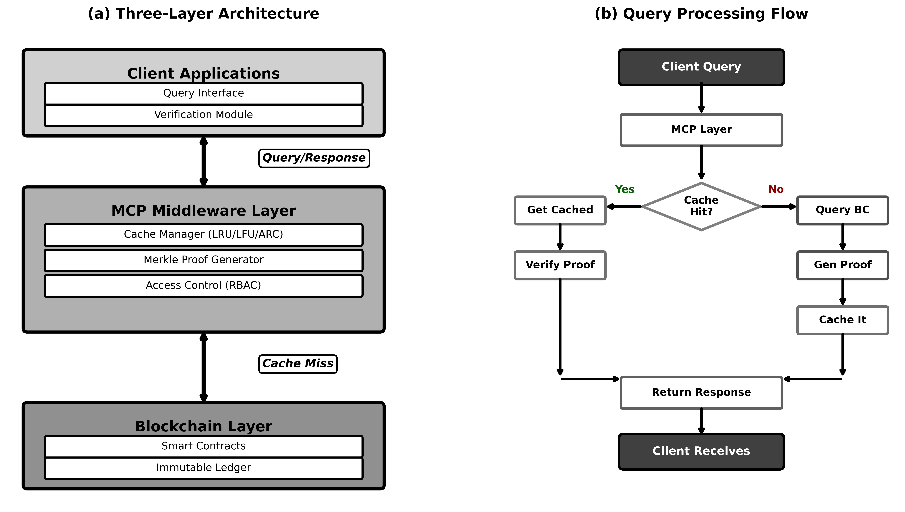
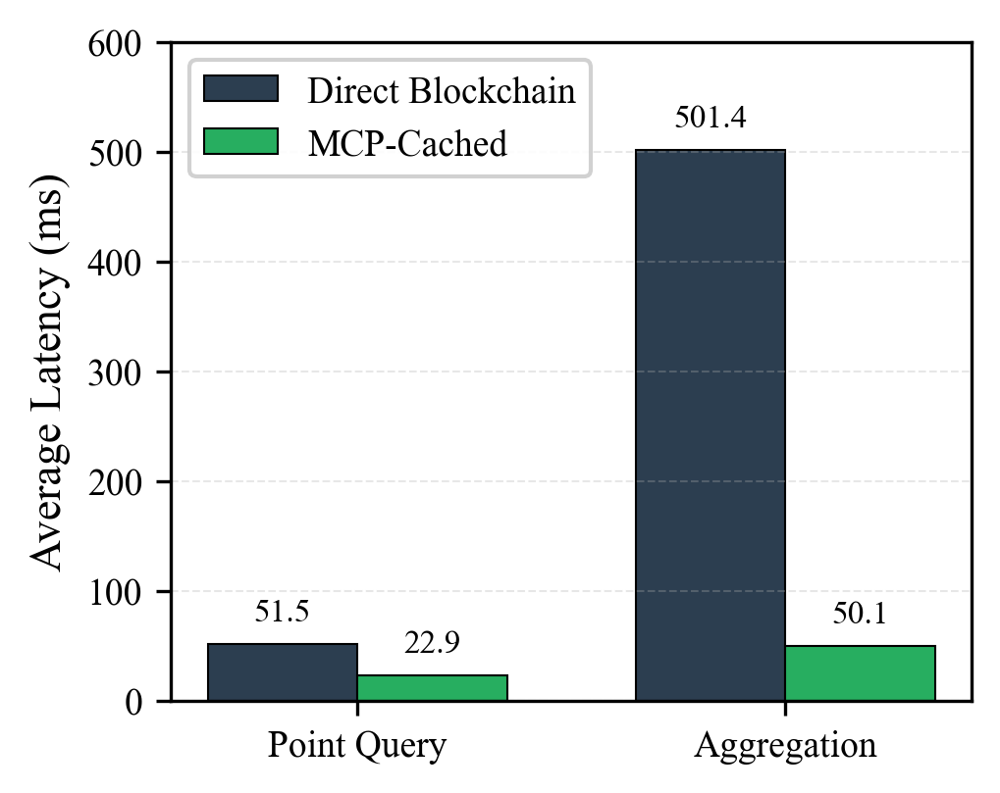
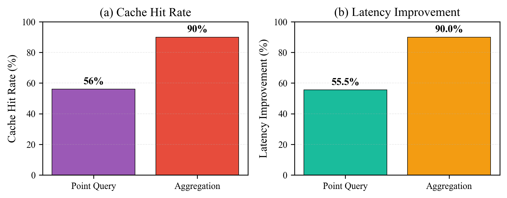
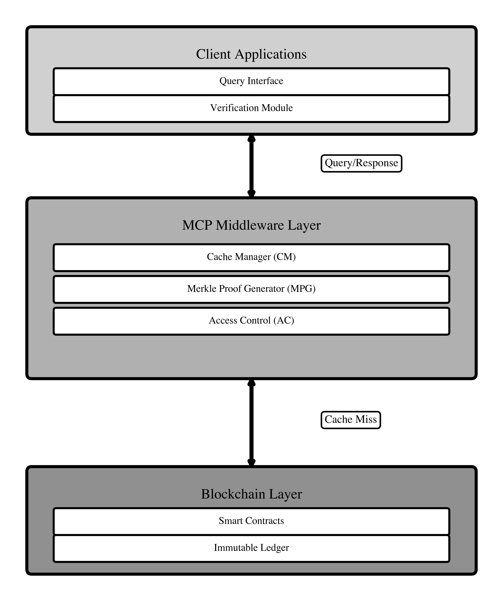
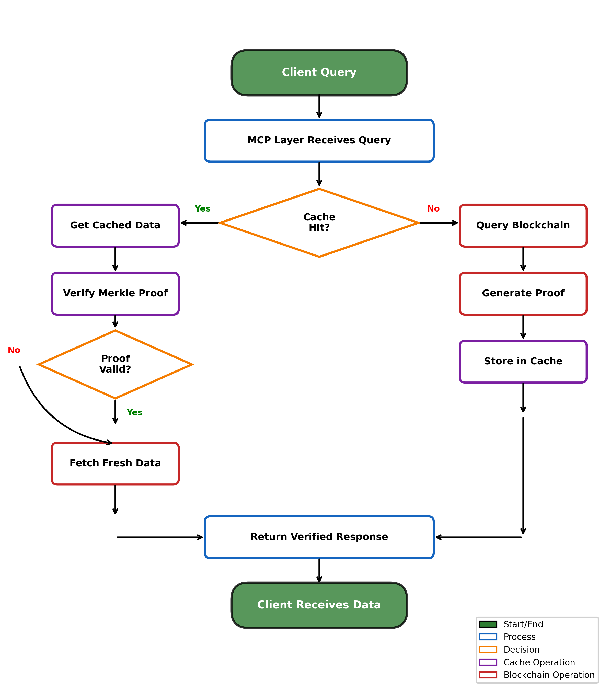
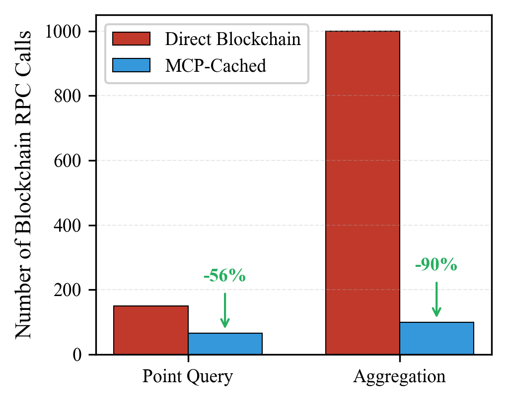

# MCP-Enhanced Blockchain Architecture for Agricultural Data Sharing: A Hybrid Caching Approach for Supply Chain Traceability

**2026 IEEE 50th Annual Computers, Software, and Applications Conference (COMPSAC)**
**DOI:** [10.1109/COMPSAC69091.2026.00420](https://doi.org/10.1109/COMPSAC69091.2026.00420)

<p align="center">
  
</p>

## Overview

This repository contains the experiment suite and raw results for the paper: a **hybrid caching layer** built on the Model Context Protocol (MCP) on top of a blockchain backbone for agricultural supply-chain data sharing. The cache is evaluated along four axes:

- **Verifiable caching** — Merkle-proof based verification so clients can check cached values against on-chain state.
- **Cache policies** — LRU, LFU, ARC, and adaptive TTL compared on hit rate.
- **Consistency** — write-triggered (event-driven) invalidation vs. fixed TTL, measured in stale reads.
- **Baselines** — direct blockchain access, a Graph-style indexer, materialized views, and a database mirror.

Everything is a self-contained in-process simulation: no live blockchain, no network I/O, no GPU.

## Repository structure

```
.
├── experiments/                      # experiment suite
│   ├── run_enhanced_experiments.py   # entry point — runs all experiments
│   ├── verifiable_cache.py           # Merkle tree, proofs, light-client verifier
│   ├── cache_policies.py             # LRU / LFU / ARC / adaptive TTL caches
│   ├── write_triggered_invalidation.py  # event-driven invalidation vs fixed TTL
│   ├── baseline_comparisons.py       # blockchain simulator + all baselines
│   ├── sensitivity_analysis.py       # TTL/size/Zipf/latency sweeps, concurrency
│   ├── multi_tenant_access.py        # multi-tenant RBAC cache
│   └── results/                      # raw results of the reported run
│       ├── comprehensive_results.json
│       └── summary.txt
├── plots/                            # figure-generation scripts (EPS + PNG)
├── figures/                          # figures used in the paper and here
├── requirements.txt                  # pinned runtime dependencies
└── README.md
```

## Experiments

| # | Experiment | Module | What it measures |
|---|------------|--------|------------------|
| 1 | Verifiable caching | `verifiable_cache.py` | Merkle proof generation / verification overhead |
| 2 | Cache policies | `cache_policies.py` | Hit rate of LRU, LFU, ARC, adaptive TTL |
| 3 | Write-triggered invalidation | `write_triggered_invalidation.py` | Staleness vs. fixed-TTL expiry |
| 4 | Baseline comparison | `baseline_comparisons.py` | Query latency vs. direct chain, indexer, views, mirror |
| 5 | Sensitivity analysis | `sensitivity_analysis.py` | TTL, cache size, Zipf skew, blockchain latency |
| 6 | Concurrency benchmark | `sensitivity_analysis.py` | p50 / p95 / p99 latency under concurrent load |
| 7 | Multi-tenant access control | `multi_tenant_access.py` | RBAC overhead per query |

## Key results

Numbers below are from the committed raw results (`experiments/results/`).

### Cache policies

| Policy | Hit rate |
|--------|----------|
| **LFU** | **85.9 %** |
| ARC | 85.5 % |
| Adaptive TTL | 84.8 % |
| LRU | 83.7 % |

### Consistency: fixed TTL vs. write-triggered invalidation

| Strategy | Hit rate | Stale reads |
|----------|----------|-------------|
| Fixed TTL | 80.0 % | 50 |
| Write-triggered | 76.6 % | **0** |

Write-triggered invalidation trades ~3 points of hit rate for complete elimination of stale reads.

### Baseline comparison (average query latency)

| System | Avg latency |
|--------|-------------|
| Database mirror | 0.02 ms |
| Materialized views | 0.58 ms |
| Graph-style indexer | 1.36 ms |
| **MCP cache layer** | **8.30 ms** |
| Direct blockchain | 53.08 ms |

The MCP cache layer is ~6.4× faster than direct blockchain access while preserving verifiability — the unverifiable baselines (mirror, views, indexer) are faster but offer no on-chain guarantees.

<p align="center">
  
</p>

### Overheads

| Mechanism | Overhead |
|-----------|----------|
| Merkle proof verification | 0.005 ms per query |
| Multi-tenant access control | ~0.000 ms per query |

<p align="center">
  
</p>

## Architecture and MCP flow

<p align="center">
  
</p>

<p align="center">
  
</p>

<p align="center">
  
</p>

The remaining paper figures are in [`figures/`](figures/).

## Getting started

Requires **Python 3.12** (verified with 3.12.2; `numpy` and `matplotlib` are pinned in `requirements.txt`).

```bash
python3 -m venv .venv
source .venv/bin/activate
pip install -r requirements.txt
```

## Running the experiments

```bash
cd experiments
python run_enhanced_experiments.py
```

- Runs all 7 experiments end-to-end; no arguments needed.
- Writes `results/comprehensive_results.json` and `results/summary.txt` (overwrites the committed raw results).
- Wall-clock runtime of the full suite: **~12 minutes (734 s measured in a fresh venv)** on a laptop-class machine.
- Pure CPU simulation; no network access or GPU required.

## Reproducing the figures

```bash
cd plots
python generate_eps_figures.py           # latency, blockchain calls, cache performance, architecture
python generate_flowchart.py             # MCP request flow diagram
python generate_flowchart_separate.py    # separate flowchart variant
python generate_architecture.py          # architecture diagram
python generate_combined_architecture.py # combined architecture diagram
python generate_comprehensive_figure.py  # comprehensive overview figure
python generate_additional_figures.py    # extra flowchart + contributions figure
```

Each script writes EPS and PNG output to the current directory.

## Raw results

- `experiments/results/comprehensive_results.json` — full machine-readable results of every experiment (all metrics, distributions, sensitivity sweeps).
- `experiments/results/summary.txt` — human-readable summary of key findings.

## Notes

- **Simulation methodology.** Blockchain latency, gas cost, cache layers, and tenants are modeled in-process (see `baseline_comparisons.py` for the blockchain simulator). Latencies are simulated milliseconds, not wall-clock times.
- **Reproducibility.** Workloads draw from an unseeded RNG, so a re-run reproduces the trends but may differ in the last digits from the committed numbers. The committed raw results are the exact run reported in the paper.
- **Dependencies.** The experiment suite uses only the Python standard library plus `numpy`; the figure scripts additionally use `matplotlib`. There are no other runtime requirements.

## Citation

```bibtex
@inproceedings{akbar2026mcp,
  title     = {MCP-Enhanced Blockchain Architecture for Agricultural Data Sharing: A Hybrid Caching Approach for Supply Chain Traceability},
  author    = {Akbar, Nur Arifin and Dembani, Rahool and Gioe, Camillo and Lenzitti, Biagio and Puleio, Vito and Sullivan, Clare and Tegolo, Domenico},
  booktitle = {2026 IEEE 50th Annual Computers, Software, and Applications Conference (COMPSAC)},
  year      = {2026},
  doi       = {10.1109/COMPSAC69091.2026.00420}
}
```
